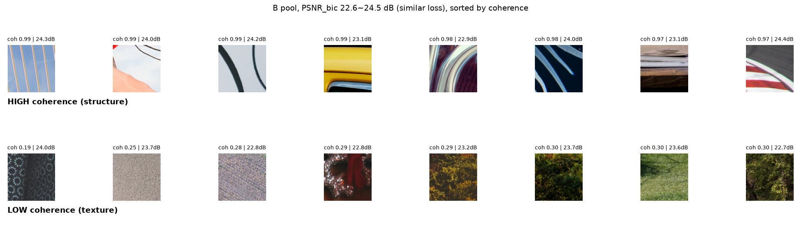

# 학습 패치 선택 기준이 소형 초해상도 모델에 미치는 영향 (SRCNN, x4)

- **질문**: 같은 수의 학습 패치라도, 잃어버린 디테일이 선·윤곽인 패치를 고르면 작은 초해상도 모델이 더 잘 배우는가?
- **방법**: 축소로 손실이 큰 패치를 손실 크기(PSNR_bic)를 맞춘 채 **선·윤곽형**과 **불규칙 무늬형**으로 나눴습니다. 각 1000개로 SRCNN을 학습해 시드 10개 × Set5+Set14(19장)·BSD100(100장)에서 비교했습니다.
- **결과**: **LPIPS만 일관되게 좋았습니다.** 사전 등록한 주 비교에서 PSNR·SSIM은 차이가 없었고, 보조 비교에서는 세트에 따라 엇갈렸습니다.
- **논문 재현이 아닙니다.** 배경 논문의 식 (1) `PSNR_bic = PSNR(X, (X↓bic4)↑bic4)`로 패치를 고르는 아이디어가 흥미로워, 이 점수 하나를 작은 모델로 확인해 본 것이 출발점입니다.
- **코드 작성·실행·분석·문서 초안은 AI(Claude)**, **실험 질문·주요 설계·가설 방향·검증 요청과 결과·문서 확인은 본인**이 했습니다. 세부 설계 일부(주 지표 LPIPS, BSD100 추가, 구조성 계산식)는 AI가 제안했습니다. 자세한 구분은 [역할 구분](#역할-구분)에 있습니다.

## 결과

시드 10개, 차이 = X − Y, [95% 신뢰구간]. 판정 규칙: 구간이 0을 포함하지 않으면 우세/열세, 포함하면 보류. LPIPS는 낮을수록 좋습니다.

| 구분 | 비교 (X − Y) | 세트 | PSNR | SSIM | LPIPS |
|---|---|---|---|---|---|
| **주 비교 (사전 등록)** | 선·윤곽형 − 기준 B | 19장 | +0.013 보류 | +0.0003 보류 | **−0.0072 [−0.0102, −0.0043] 우세** (19/19장) |
| | | BSD100 | −0.004 보류 | −0.0007 보류 | **−0.0053 [−0.0080, −0.0026] 우세** (97/100장) |
| 보조 비교 (탐색, 보정 없음) | 선·윤곽형 − 불규칙 무늬형 | 19장 | +0.073 우세 | +0.0019 우세 | −0.0170 우세 |
| | | BSD100 | +0.014 보류 | −0.0009 열세 (경계선상\*) | −0.0111 우세 |
| 보조 비교 (탐색, 보정 없음) | 기준 B − A (원래 질문) | 19장 | +0.058 우세 | +0.0008 우세 | −0.0086 우세 |
| | | BSD100 | +0.026 우세 | +0.0002 보류 | −0.0056 우세 |

- 그룹 정의:
  - **A**: 8000개 패치 중 무작위
  - **기준 B**: 손실 큰 패치(PSNR_bic 하위 50%) 중 무작위
  - **선·윤곽형 / 불규칙 무늬형**: 기준 B와 같은 풀에서 손실 크기를 맞춘 뒤, 구조성(밝기 변화 방향이 정렬된 정도)이 높은 쪽 / 낮은 쪽
- BSD100은 가설 수립과 탐색에 쓰지 않은 독립 확인 세트입니다.
- \* 정밀값 −0.000874 [−0.001721, −0.000027]. 구간 상한이 0에 매우 가까워 약한 신호로만 읽습니다.
- 시드 0 모델의 확대 비교에서는 모델 간 차이가 눈으로 거의 구분되지 않았습니다([compare_final.png](outputs/compare_final.png)).



*손실 크기가 비슷한(PSNR_bic 22.6\~24.5 dB) 패치 중 구조성이 가장 높은 8개(위, 그림 라벨 structure = 선·윤곽형)와 가장 낮은 8개(아래, texture = 불규칙 무늬형).*

## 역할 구분

`EXPERIMENT_LOG.md`의 표기를 그대로 옮겼습니다.

| 본인 [사용자] | AI [Claude] |
|---|---|
| 실험 질문, 실험 원칙, A/B/C 3조건 설계, 중앙값 기준, 패치 크기 96, 지표(PSNR·SSIM·LPIPS), 데이터셋(DIV2K, Set5/Set14), SRCNN류 소형 모델, 조건 간 학습 설정 동일 | 모든 코드 작성과 실행(학습·평가), 분석, 기록·문서 초안 작성 |
| 임계값 하나로 나누는 분할에서 벗어나자는 방향 결정 | 패치 풀 구성, N=1000, 모델 세부(잔차 학습, 0 초기화), 학습 설정값, 평가 세부 방식 |
| 배경 요약문(MSE와 시각 인지의 괴리) 제공 | 요약문 검토·정정, 분할 후보 ①\~⑤ 제시 |
| 후보⑤ 채택(손실 크기를 맞추고 구조성만 다르게) | Sobel 필터 제안·구현, 구조성 정의의 나머지와 층화 방식 |
| Sobel 필터를 이해하고 채택 | 시드 수 10, Welch 신뢰구간, 판정 규칙 제안 |
| 판정 규칙 채택, 최종 후보만 시드 10개로 확인, DIV2K_valid 미사용 | 주 비교·주 지표(LPIPS) 지정, BSD100 추가, 그림 선택 규칙, 추가 점검 |
| 선·윤곽형 vs 기준 B 최종 확인·시각 비교·신뢰성 점검 요청, 그룹 이름 결정 | 선명도(경계 세기) 탐색 분석, 결론 문장 초안 |

- **가설에 이른 흐름 [사용자 진술]**: 임계값 분할에서 벗어나고 싶었다 → 같은 "디테일 많은 패치"라도 종류를 구별하려 했다 → 사람 눈에는 선·경계가 중요하다는 직관으로 가설을 세웠다. 바탕은 수강 중인 영상처리 과목의 강의 자료와 본인의 직관이다.
- 이 직관을 학습과 잇는 설명("MSE로 학습하면 예측할 수 있는 선·윤곽의 손실에서 더 많이 배운다")은 Claude가 분할 후보를 설명하며 제시했습니다 **[Claude]**. 자세한 내용은 [REPORT.md](REPORT.md#가설과-그-출처)에 있습니다.
- 사용자는 LPIPS를 주 지표로 정한 이유를 학문적으로 이해하지 못한 채 진행했습니다. 별도의 승인 단계는 없었습니다.

## 한계

- **주 지표 LPIPS는 시드 3개 결과를 본 뒤 정했습니다.** 그 시드 0\~2가 최종 10개에 포함되므로, 19장의 주 비교는 완전히 독립적인 확인이 아닙니다. 결과를 보기 전에 확인한 것은 시드 3\~9와 BSD100입니다.
- **섞인 변수**: 손실 크기는 맞췄습니다(PSNR_bic 23.24\~23.29 dB). 그러나 그룹마다 대비와 원본 사진 수가 다릅니다.
  - 대비: 선·윤곽형 54.9, 기준 B 51.0, 불규칙 무늬형 47.2
  - 원본 사진 수: 472, 533, 462
  - 따라서 차이를 구조성만의 효과로 단정할 수 없습니다.
- **범위**: 모델 SRCNN 하나(파라미터 20,099개), 열화 방식 x4 bicubic 하나, 학습 패치 1000개, LPIPS는 AlexNet 한 종류뿐입니다.
- 탐색한 분할 기준이 2개이고, 보조 비교는 다중 비교 보정을 하지 않았습니다.

## 실행 방법과 환경

환경은 Windows, Python 3.14.2, NVIDIA RTX 3060 Ti, torch 2.14.1+cu126입니다. 학습은 1회(1000개 × 100 에폭)에 약 60\~65초 걸렸고, 최종 평가(08 final)는 실험당 약 2분 10초\~2분 30초 걸렸습니다.

```bash
# torch, torchvision을 CUDA 버전에 맞게 먼저 설치한 뒤
pip install -r requirements.txt
python 00_download_div2k.py ; python 06_download_benchmarks.py      # 데이터 (저장소에 미포함)
python 01_make_patches.py ; python 02_score_patches.py ; python 02b_score_structure.py
python 03_make_groups.py baseline final ; python 03_make_groups.py coh_strat final
python -u 07_train.py B 0 coh_strat | tee outputs/exp/coh_strat/train_B0.log   # (조건, 시드, 실험)마다 1회
python 08_evaluate.py coh_strat final ; python 11_compare_runs.py coh_strat:B baseline:B final
```

- 전체 학습 반복문과 분석 순서는 [REPORT.md](REPORT.md#재현-방법)에 있습니다.
- 결정론 설정이 없어 같은 시드로도 학습 결과가 아주 조금 다를 수 있습니다.
- **재현 확인 (2026-10-08)**:
  - 새 가상환경에서 위 설치 순서대로 설치하니, 설치된 패키지 목록이 실험 환경과 같았고 GPU도 인식했습니다.
  - `01_make_patches.py`를 다시 실행해 만든 `patches.npy`와 `patch_meta.npy`는 원본과 SHA-256이 같았습니다.
  - `02_score_patches.py`를 다시 실행해 만든 `scores.npy`도 원본과 SHA-256이 같았습니다.
  - 데이터 다운로드(00, 06)와 학습·평가(07, 08)는 다시 실행하지 않았습니다.

## 데이터 출처와 라이선스 주의

- **DIV2K** (학습): 공식 배포처에서 받았습니다.
- **Set5, Set14, BSD100** (평가): Hugging Face **커뮤니티 미러**(eugenesiow)에서 받았습니다. 공식 배포처가 아닙니다.
- 모두 학술 연구용으로 배포된 데이터셋입니다. 이 저장소에는 포함하지 않으며, 사용할 때는 원 배포처의 조건을 확인해야 합니다.

## 폴더 구조

```
00_~14_*.py, config.py, splits.py, srcnn.py   실험 코드 (파일별 설명: CODE_MAP.md)
outputs/exp/baseline/, outputs/exp/coh_strat/  실험별 그룹·모델·로그·사진별 결과
outputs/*.png, group_checks.txt, sharpness.txt 그림과 점검 결과
REPORT.md          상세 보고서 (가설의 출처, 사전 등록, 전체 결과, 결정 기록, 실험 원칙)
EXPERIMENT_LOG.md  날짜별 실험 기록 (원본 기록, 끝에 점검 수정 항목)
CODE_MAP.md        코드 구조와 수정 방법
```

코드 구조는 [CODE_MAP.md](CODE_MAP.md)에 있습니다. 로그와 일부 출력은 옛 표기("구조/텍스처", `struct/texture`)를 쓰며, 각각 선·윤곽형/불규칙 무늬형과 같은 그룹입니다.

**배경 논문**: 조선우, 정예진, 소재웅, 조남익 (2024). "Label-Free and Architecture-Agnostic Dataset Distillation for Single Image Super-Resolution."
